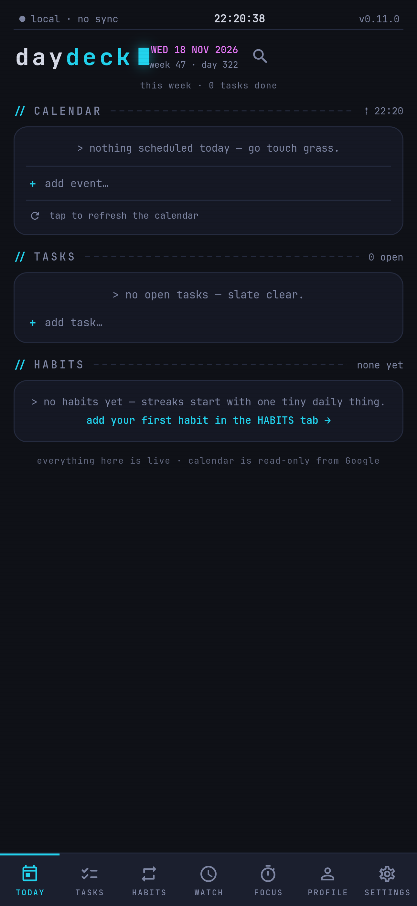
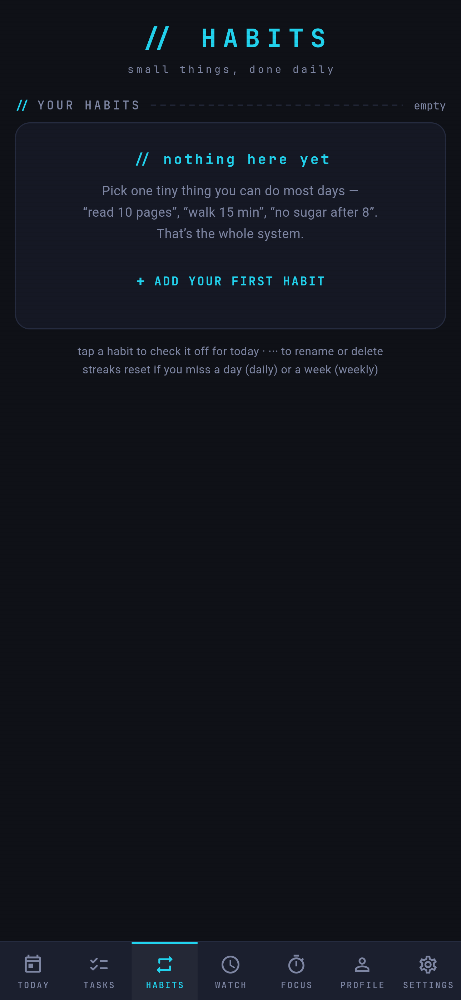
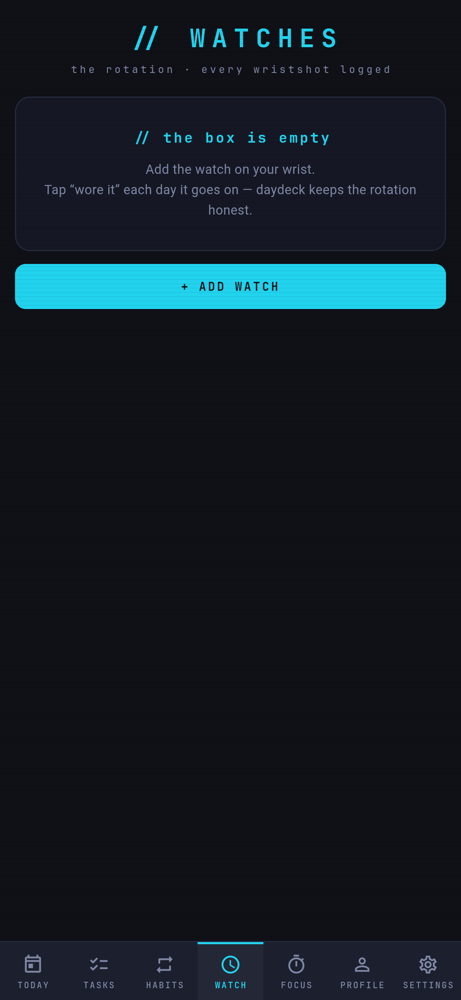
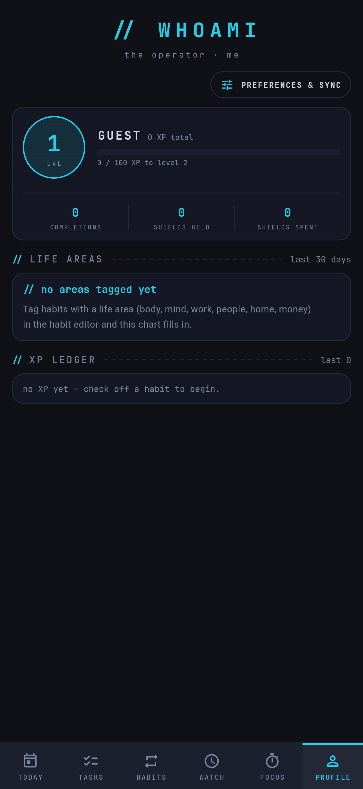
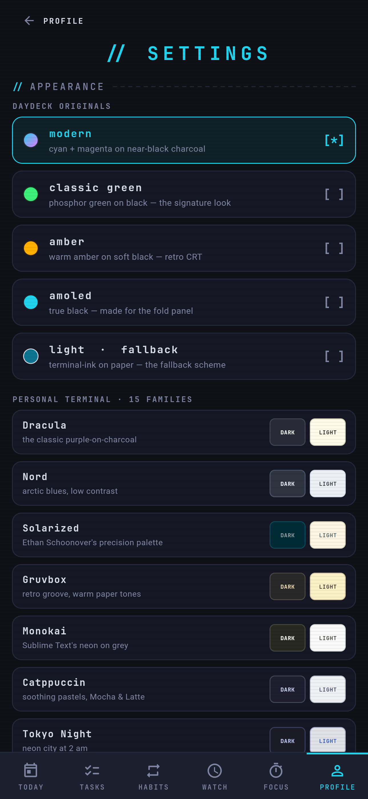

# DayDeck

<p align="center">
  
</p>

`daydeck` — a single-user, **terminal-styled daily dashboard** for Android (sideloaded APK) and iPhone (unsigned IPA re-signed on-device via Signulous), plus a web build for the desktop. Offline-first, no server of your own, no Google sign-in.

> Today's view · tasks · local events (private or queued for Google Calendar) · habits with streaks


---

## Status

**v0.12.0 candidate — release pending native CI**. Adds the full habit editor (checkboxes, counters, timers, checklists, schedules, targets, reminders, ramps, anchors and life areas), late-log and shield repair controls, Today command prompt, weekly review + 12-week heatmap, watch rotation/strap/service tools, and safe JSON backup import/merge. Existing Android APK and unsigned iOS IPA remain on v0.11.0 while the candidate builds are verified. Sync stays compatible with existing `dashboard-data` records; watch photos remain device-local. See [PROJECT_NOTES.md](PROJECT_NOTES.md) for release and test details.

## iPhone-sized screenshots

Current unreleased UI preview, captured from the Flutter web build at a 430 × 932 viewport and 3× scale (1290 × 2796 pixels). These are not physical iPhone or iOS Simulator captures; sample data is intentionally empty.

<p align="center">
  
  
  
  
  
</p>

## Install (iPhone)

1. Open the [Releases](https://github.com/TheSwagInDisguise/dashboard-app/releases) page on your phone or computer.
2. Download `DayDeck-unsigned.ipa` from the latest release (it is an *unsigned* build — CI never touches Apple signing credentials).
3. Upload the IPA at [signulous.com](https://www.signulous.com/); their signing platform re-signs it with its own certificate and gives you an install link for your iPhone.
4. Install from that link, then trust the certificate on the phone: **Settings → General → VPN & Device Management**.

No Xcode, no Mac, no Apple Developer membership required. Signing happens on Signulous' side — check their docs for certificate lifetimes and re-install when it expires.

## Install (Android)

1. Open the [Releases](https://github.com/TheSwagInDisguise/dashboard-app/releases) page on your phone.
2. Download `app-release.apk` from the latest release.
3. Tap it; allow “install unknown apps” for your browser/file manager if prompted (one-time system dialog).
4. DayDeck appears in your launcher. Future APKs install over the top of older ones.

## Privacy & secrets

- This repository contains **code only — no tokens, no calendar data, no personal content, ever.**
- At runtime the app asks you for a GitHub token (created for you in **Settings → how to create your sync token**) and stores it **only on that device**, in platform secure storage. It is never synced, never logged, never shown again.
- Google Calendar is read **view-only** through your calendar's secret iCal address. DayDeck never signs in to Google and never writes to your calendar except via explicit one-tap “create event” links you open yourself.
- Shared/queued state lives in your **private** `dashboard-data` repo as plain JSON files (it is a data store, not a server).

## Build from source

```bash
flutter --version   # 3.47.9 stable
flutter pub get
flutter analyze
flutter test
flutter build apk --release   # signed if android/key.properties exists (CI only)
flutter build web --release
```

Releases are cut by pushing a tag `vX.Y.Z`; the [release workflow](.github/workflows/release.yml) builds the signed APK **and** the unsigned IPA, and publishes both to a GitHub Release.

## Layout

```
lib/
  theme/     palette tokens (4 schemes) + ThemeData builder + JetBrains Mono
  state/     app-wide state (scheme, reminder time, iCal URL, sync token)
  data/      sample data (Phase 1 only — replaced by real stores later)
  screens/   today / tasks / habits / settings + bottom-nav shell
  widgets/   scanline overlay, blinking cursor, section rules, chips
.github/workflows/release.yml   tag-driven signed-APK + unsigned-IPA build → GitHub Releases
assets/      icon + OFL-licensed JetBrains Mono (assets/fonts/OFL.txt)
```

## License

MIT — see [LICENSE](LICENSE). Font: JetBrains Mono, SIL Open Font License 1.1.
